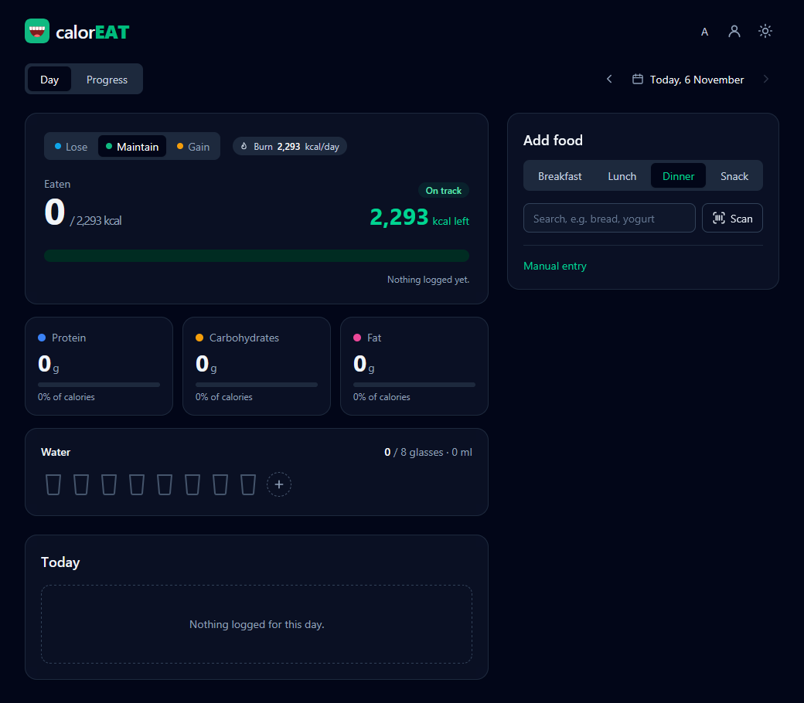
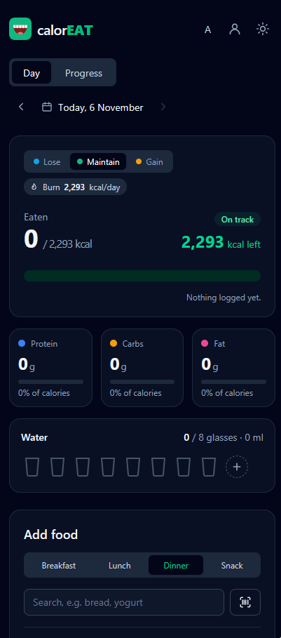

<h1 align="center">calorEAT</h1>

<p align="center">
  A fast, private calorie and macro tracker that runs entirely in your browser.
</p>

<p align="center">
  <a href="https://ramoneus.github.io/CalorieEAT/"><strong>Live demo</strong></a>
  ·
  <a href="#features">Features</a>
  ·
  <a href="#getting-started">Getting started</a>
</p>

<p align="center">
  <a href="https://github.com/ramoneus/CalorieEAT/actions/workflows/deploy.yml"></a>
  
  
  
  
  
</p>

<p align="center">
  
  
</p>

## Overview

calorEAT works out a personal daily calorie goal from your body stats and activity level, then helps you log what you eat against it. You can find foods by searching or by scanning a barcode, and you can follow your progress over weeks.

There is no account and no server. All data stays on your device, the app installs to your home screen, and it keeps working offline.

## Features

**Personal goal**
- Uses the Mifflin-St Jeor equation to estimate your BMR and maintenance calories (TDEE), with a live preview during setup.
- Lets you choose to lose, maintain or gain weight at a weekly rate and an optional target weight. The app estimates the date you'll reach it.
- Will not set a goal for losing weight below a safe minimum (1,200 kcal for women, 1,500 kcal for men).

**Logging food**
- Search about 900 Greek and everyday foods, dishes and brands, with ready-made portions (slice, cup, medium) or grams. The search ignores case and accents.
- Scan a barcode with the camera to get a packaged product's nutrition from Open Food Facts. Scanned products are saved and work offline afterwards.
- Every entry goes under breakfast, lunch, dinner or snack. Recent foods and favourites can be added again with one tap, or you can repeat yesterday's meal.
- You can edit any entry, undo a deletion, or type in calories and macros by hand.

**Tracking progress**
- The dashboard shows calories eaten against the goal, how many are left, and protein, carbs and fat with each one's share of calories.
- A calendar lets you move through past days, with each day marked as within or over the goal.
- Charts show daily calories and body weight over 7, 30 or 90 days, with averages.
- A water tracker counts glasses towards a daily goal.

**Everyday use**
- Several local profiles can share one device.
- Units can be metric or US customary (lb, ft/in, oz). Data is always stored in metric, so switching units loses no precision.
- Light and dark themes, a responsive layout for phones and desktops, and accessible labels throughout.
- You can back up all your data to a file and restore it on another device.

## How the goal is calculated

```
BMR          = 10 × weight (kg) + 6.25 × height (cm) − 5 × age + 5      (men)
BMR          = 10 × weight (kg) + 6.25 × height (cm) − 5 × age − 161    (women)
Maintenance  = BMR × activity factor   (1.2 · 1.375 · 1.55 · 1.725)
Daily goal   = Maintenance ± (weekly rate × 7,700 kcal/kg) ÷ 7
```

When your profile changes, only the goals from that day on change. Past days keep the goal they had, so your history stays accurate.

> These figures are estimates for general guidance, not medical advice.

## Tech stack

| Area      | Choice                                                                    |
| --------- | ------------------------------------------------------------------------- |
| UI        | React 19 with function components and hooks                               |
| Styling   | Tailwind CSS 4 with a class-based dark mode                               |
| Build     | Vite 8                                                                    |
| Storage   | `localStorage`, with a separate namespace for each profile                |
| Offline   | Web app manifest and a service worker                                     |
| Barcodes  | Native `BarcodeDetector` API, with a `zxing-wasm` fallback                |
| Charts    | Hand-written SVG, with no chart library                                   |
| Testing   | Vitest unit tests for all the calculation and data logic in `src/lib`     |
| CI/CD     | GitHub Actions lints, tests and builds every push and pull request; `main` deploys to GitHub Pages only when every check passes |

## Getting started

The app is live at **[ramoneus.github.io/CalorieEAT](https://ramoneus.github.io/CalorieEAT/)**. To install it on your phone, use **Install** in the app header (Chrome, Edge, Android) or **Share → Add to Home Screen** (Safari on iOS).

To run it locally you need [Node.js](https://nodejs.org/) 20 or newer:

```bash
git clone https://github.com/ramoneus/CalorieEAT.git
cd CalorieEAT
npm install
npm run dev
```

Then open http://localhost:5173. On Windows you can also double-click `run.bat`.

| Script            | What it does                         |
| ----------------- | ------------------------------------ |
| `npm run dev`     | Starts the dev server with hot reload |
| `npm run build`   | Creates a production build in `dist/` |
| `npm run preview` | Serves the production build locally  |
| `npm run lint`    | Lints the code with oxlint           |
| `npm test`        | Runs the unit tests once             |
| `npm run test:watch` | Re-runs the tests on every change |

## Privacy

Everything you enter is stored only in your browser's `localStorage`. The one network request is a barcode lookup, and it sends Open Food Facts only the barcode number. Clearing the site's data in your browser resets the app.

## License

Released under the [MIT License](LICENSE).

Product data from barcode scans comes from [Open Food Facts](https://world.openfoodfacts.org), under the [Open Database License](https://opendatacommons.org/licenses/odbl/1-0/).
